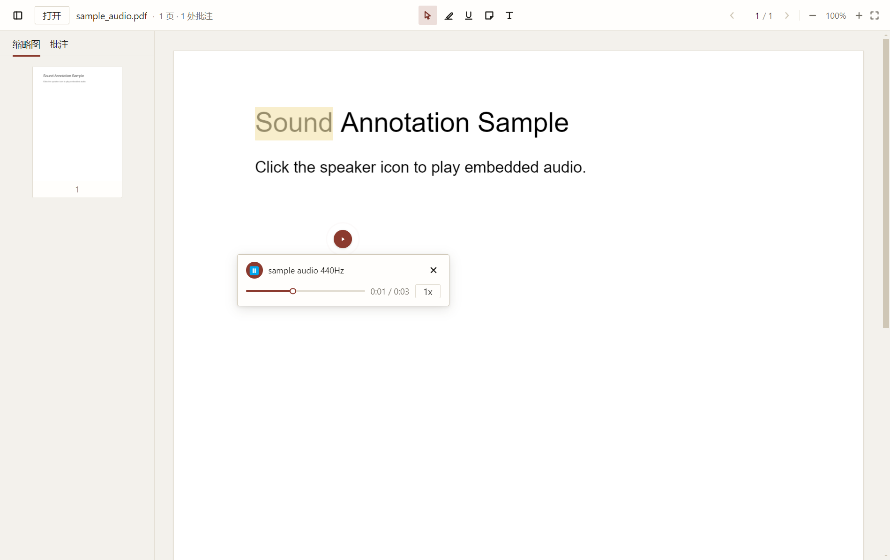

# u32-pdf-reader

简洁的 Windows 桌面 PDF 阅读器：**读 PDF、做批注、听内嵌音频**。全本地运行，不联网、不写回原 PDF。



主页（GitHub Pages）：<https://vtxf.github.io/u32-pdf-reader/>

## 为什么做这个阅读器

作者常给小孩看英文自然拼读（Phonics）类的 PDF 绘本，其中不少 PDF 自带朗读音频。但实测下来，除了 Adobe 家的阅读器，其他几乎所有工具都播不出声音——福昕、各类小众 PDF 阅读器，甚至浏览器内置的 PDF 查看器，都不支持。

这个功能明明很有用，却一直缺一个轻量的实现。过去没有 AI，独立开发成本太高；现在条件成熟了，就动手做了这一个。

我不想用 Adobe，原因很简单：安装包太大、UI 太复杂。我需要的只是一个**能看、能简单批注、能播放内嵌音频**的小型 PDF 阅读器——于是就有了它。希望这个工具对你也有帮助。

两点说明：

- 音频播放条带进度条，可以**拖拽控制播放进度**，不用从头听
- UI 说不上好看，但**功能是真的能用**；界面以后有机会再改进，先用起来要紧

## 功能

### 阅读

- pdf.js 连续滚动；页面按需渲染（只画可视区附近，离屏释放位图），60 页文档冷启动约 70ms，常驻 canvas ≤2
- 顶栏页码跳转、缩放（Ctrl+滚轮 / Ctrl+± / Ctrl+0 适应宽度）、侧栏可折叠
- 每页 canvas 之上叠一层透明文本层：文字可选、可复制，是高亮 / 下划线的前提
- 拖拽 PDF 到窗口直接打开

### 批注

五种工具：**指针 · 高亮 · 下划线 · 便签 · 文字**

- 指针模式下选中文字即浮出工具条，一步打高亮 / 下划线；也可先按 H/U 再选（切到高亮工具后选文字自动套用）
- 便签（N）、文字（T）进放置模式（十字光标），点页面任意位置就地弹窗输入；点击已有的便签 / 文字批注可重新编辑，内容清空即删除
- 侧栏「批注」栏列出全部批注，点击跳转、可删除；「缩略图」栏切换页面
- 批注存旁注文件 `<同名>.annotations.json`，归一化坐标（0–1），换缩放 / 换屏不漂移

### 内嵌音频

- 解析 PDF 的 Sound 注解，页面上的音频图标点一下，**在该图标下方浮出播放条**（不是固定底栏）
- 多音频互斥播放：点第二个图标，播放条迁移过去并切换音源
- 靠近页面右缘时向左展开并钳制在页面内，靠近底部时自动翻到图标上方
- 进度条可拖拽、倍速 0.5–2x、可暂停；关闭方式：× / Esc / 再点同一个图标

### 快捷键

| 键 | 作用 |
|---|---|
| `Ctrl+O` | 打开 PDF |
| `V` / `H` / `U` / `N` / `T` | 指针 / 高亮 / 下划线 / 便签 / 文字 |
| `←` `→` | 上一页 / 下一页 |
| `Ctrl+滚轮`、`Ctrl+=`、`Ctrl+-`、`Ctrl+0` | 放大 / 缩小 / 适应宽度 |
| `Esc` | 逐层退出（便签弹窗 → 播放条 → 选区浮条 → 回到指针工具） |

## 技术栈

Electron 33 + TypeScript 5.7（`strict`）+ 原生 DOM（无框架）+ Vite 6 + pdfjs-dist 4.10 + @vtxfp/vtxf-basic-tools-202607（私有包，`Destroyable` / `react` / `watch`）

运行环境：Windows 10/11 x64。

## 开发

```bash
npm install        # electron 下载慢时: ELECTRON_MIRROR=https://npmmirror.com/mirrors/electron/ npm install
npm run dev        # vite (5173) + electron 开发模式
npm run typecheck  # tsc --noEmit
npm run build      # 主进程 esbuild + 渲染层 vite build
npm run dist       # NSIS 安装包 → out/u32-pdf-reader-<版本>-setup.exe
npm run pack       # 免安装绿色版 → out/win-unpacked/
```

> Windows 本机若全局有 `ELECTRON_RUN_AS_NODE=1`，启动前必须 `unset`，否则 electron 会退化成纯 Node 进程。

> 依赖里的 `@vtxfp/vtxf-basic-tools-202607` 是内部私有包（不在公共 npm 上），所以从公开仓库克隆后 `npm install` 拉不全、无法完整构建；仓库只提供 `.npmrc.example` 占位，不携带私服地址。看源码、用成品不受影响。

## 打包产物

| 文件 | 说明 |
|---|---|
| `out/u32-pdf-reader-0.1.0-setup.exe` | NSIS 安装包（约 78 MB），可选安装目录，快捷方式「u32 PDF 阅读器」 |
| `out/win-unpacked/u32-pdf-reader.exe` | 免安装绿色版（`npm run pack` 生成；目录被占用时自动改写为 `out/portable-<时间>/`） |

打包脚本是 `scripts/dist-app.mjs`，不是直接调 `electron-builder`。原因：本机工作区内的 `app.asar` 会被
后台文件索引进程长期持有句柄，直接覆盖会报 `The process cannot access the file` 并中断。脚本改为
**先打到系统临时目录，成功后再把安装包搬回 `out/`**；旧绿色版目录仍被占用时自动改名，不影响出包。

图标由 `python scripts/make-icon.py` 生成 `build/icon.ico`（赭红底 + 纸面 + 音波，与界面同色系），已随仓库提交，
electron-builder 打包时自动嵌入 exe 与安装包。

## 测试

```bash
node scripts/make-sample.mjs test     # 重新生成带 Sound 注解的样本 PDF（内嵌 440Hz WAV）
node scripts/e2e-verify.mjs           # E2E（开发版，需 vite 5173 + electron --remote-debugging-port=9222）
node scripts/e2e-verify-packaged.mjs  # E2E（打包版，端口 9223）
```

E2E 走 CDP 驱动真实界面，共 20 项断言：顶栏结构 / 打开流程 / 首屏页面与文本层 / canvas 内容 / 真实选区 /
选区浮条 / 高亮入库 / 便签弹窗（并断言未调用 `window.prompt`）/ 侧栏批注列表 / 音频图标 / 播放条锚定在图标
下方 / 进度推进 / 倍速 / 暂停 / 收起复位。

## 旁注文件格式

批注写到 PDF 同目录的 `<同名>.annotations.json`，不修改原文件。文件内容就是一个记录数组：

```json
[
  {
    "id": "a1b2c3d4e5",
    "type": "highlight",
    "page": 1,
    "rects": [[0.28, 0.17, 0.38, 0.2]],
    "text": "Sound",
    "createdAt": 1763800000000
  }
]
```

- `type` ∈ `highlight | underline | note | text`
- `page` 是 1 基页码
- `rects` 是 `[x1, y1, x2, y2]`，相对页面宽高的归一化坐标（0–1，左上原点），高亮 / 下划线每行一项；
  便签 / 文字存退化成一个点（`x1 = x2, y1 = y2`）
- `text` 是高亮/下划线命中的原文（最多 300 字）或便签/文字的内容

## 架构

```
src/
├── main/        # Electron 主进程
│   ├── main.ts       # 窗口 + IPC：打开对话框 / 读 PDF / 旁注读写
│   └── preload.ts    # contextBridge 暴露 window.bridge（含 webUtils 拖拽取路径）
└── renderer/
    ├── App.ts              # 装配与编排：打开文档、工具切换、批注增删、键盘与拖拽
    ├── Viewer.ts           # 滚动容器、页面懒渲染、当前页检测、缩放
    ├── PageView.ts         # 单页三层：canvas + textLayer + annotationLayer + 音频图标
    ├── AnnotationStore.ts  # 批注状态（react）+ 旁注 JSON 读写
    ├── AnnotationLayer.ts  # 单页批注 DOM 与选区→归一化矩形换算
    ├── TopBar.ts           # 顶栏（侧栏开关 / 打开 / 文件名 / 五工具 / 页码 / 缩放）
    ├── Sidebar.ts          # 侧栏（缩略图 + 批注两栏，缩略图按需渲染）
    ├── SelectionToolbar.ts # 选区浮条
    ├── NotePopover.ts      # 便签/文字就地弹窗
    ├── AudioPlayer.ts      # 浮动播放条（锚定音频图标）
    ├── audioExtract.ts     # 扫描 PDF 对象提取 Sound 注解音频（FLATE 解压）
    ├── EmptyState.ts       # 首屏空状态
    ├── icons.ts            # 内联 16px 线性图标
    └── styles/             # tokens.css（设计 token）+ app.css（组件样式）
```

几条关键设计：

- **视图只 watch 响应式状态**（`react` 三段一体），各自改自己的 DOM；业务逻辑只写状态，不直接操作别人的节点
- **音频提取**绕过 pdf.js 注解 API（拿不到原始流）：先用 `page.getAnnotations()` 拿到页码与 `/Rect`，用注解 id
  （形如 `"12R"` = 对象号）和自研扫描器对齐，再从原始字节里取 `/Sound` 流的音频（`/FlateDecode` 用
  `DecompressionStream` 解压）
- **页面坐标**一律经 `page.getViewport()` 换算（`convertToViewportPoint`），不假设 612×792 页宽；批注存归一化
  坐标，缩放 / 换屏不漂移
- **文本层**用 pdf.js 4.10 的 `TextLayer`，容器必须 `position:absolute;inset:0` 且父级设 `--scale-factor`

## 已知限制

- 只支持单窗口、单文档；没有标签页
- 批注只存旁注 JSON，不写回 PDF（换机器需连同 `.annotations.json` 一起拷）
- 只提取 Sound 注解里的声音流；RichMedia / 视频注解暂不处理
- 只做浅色主题（`tokens.css` 已按「换 token 即换肤」组织，暗色未实现）
